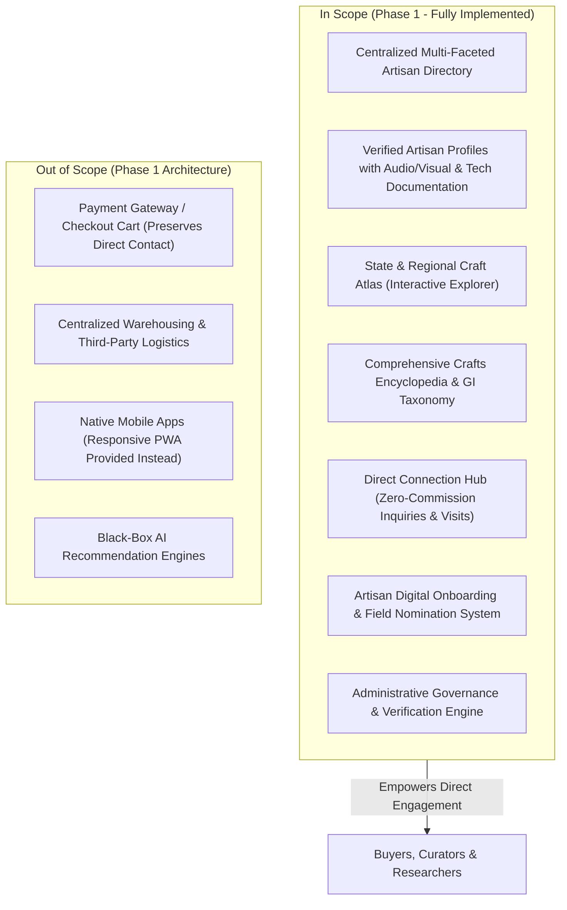

# Product Requirements Document (PRD)
## The Traditional Craft Directory (TCD)
### A Centralized Digital Platform for India's Traditional Artisans and Craft Communities

**Document Version:** 1.0.0  
**Status:** Approved & Implemented  
**Lead Authority:** Cultural Informatics & Heritage Technology Initiative  
**Target Beneficiaries:** Traditional Artisans, Master Craftspersons, Cultural Researchers, Institutional Curators, Direct Ethical Buyers  
**Institutional References:**
- [Ministry of Textiles, Government of India](https://texmin.gov.in/)
- [Office of the Development Commissioner (Handicrafts)](https://handicrafts.nic.in/)
- [Unified Mentor](https://www.unifiedmentor.com/)
- [Geographical Indications Registry of India](https://ipindia.gov.in/)

---

## 1. Executive Summary & Vision

India possesses one of the world's richest living heritage craft ecosystems, spanning over 3,000 distinct traditional crafts, 7 million practicing artisans, and hundreds of Geographical Indication (GI) tagged traditions. However, the artisan community remains historically vulnerable due to systemic barriers:

1. **Information Asymmetry & Middlemen Dependency:** Intermediaries extract 60%–80% of retail margins while artisans earn subsistence wages.
2. **Digital Invisibility:** Over 90% of genuine master artisans lack indexed digital presence, verified online portfolios, or direct discovery channels.
3. **Counterfeits & Powerloom Knockoffs:** Machine-made knockoffs undermine authentic handloom and handicraft traditions.
4. **Middleman Gatekeeping:** Institutional buyers, museums, architects, and conscious consumers cannot easily verify authentic master craftspersons or reach them directly without middlemen.

**The Traditional Craft Directory (TCD)** provides a centralized, government-standard digital infrastructure designed to document, promote, verify, and directly connect India's traditional artisans with global buyers, researchers, and institutions—operating on a **zero-middleman, direct-connection model**.

---

## 2. Product Objectives

### 2.1 Primary Objectives
- **Centralized Digital Directory:** Establish a unified, verified registry of traditional master artisans and craft communities across all Indian States and Union Territories.
- **Middleman Disintermediation:** Eliminate commercial intermediaries by providing direct artisan contact channels (phone, WhatsApp, verified studio addresses, and direct inquiry routing).
- **Heritage Preservation:** Digitally document endangered techniques, historical lineages, raw materials, and traditional tools before they become extinct.
- **Verification & Authentication:** Institute a rigorous verification system linked with government authorities (Development Commissioner of Handicrafts, National Award registers, GI Tag registries).
- **Ethical Direct Sourcing:** Facilitate direct institutional orders, custom architectural commissions, and workshop visit scheduling without agency markups.

### 2.2 Secondary Objectives
- Enhance public and youth awareness of India's cultural craftsmanship.
- Promote Geographical Indication (GI) tag literacy among buyers and collectors.
- Support rural livelihood sustainability and economic self-reliance (Atmanirbhar Bharat).
- Foster community pride and intergenerational knowledge transfer within artisan hamlets.

---

## 3. Scope of Product (Phase 1)



---

## 4. User Personas & User Journeys

### 4.1 Persona A: Direct Ethical Buyer / Collector
- **Profile:** Maya Sen, Interior Architect, Mumbai.
- **Need:** Seeking 12 authentic Bidriware silver-inlaid panels for a heritage hotel lobby; wants to bypass luxury retail showrooms to ensure 100% money goes directly to the master artisan.
- **Journey:** Visits TCD $\rightarrow$ filters by Category: *Metalwork* and State: *Karnataka* $\rightarrow$ reads Shah Rasheed Ahmed Quadri's verified profile $\rightarrow$ reviews technique and GI credentials $\rightarrow$ submits direct inquiry with dimensions $\rightarrow$ directly calls artisan's workshop in Bidar without any middleman fee.

### 4.2 Persona B: Cultural Researcher / Anthropologist
- **Profile:** Dr. Raghavan Nair, Textile Historian, New Delhi.
- **Need:** Documenting surviving Persian-origin Kani needle-weaving techniques and Talim encrypted scripts in the Kashmir Valley.
- **Journey:** Explores Craft Heritage page $\rightarrow$ selects *Kani Pashmina Shawl Weaving* $\rightarrow$ inspects historical era and tool descriptions $\rightarrow$ connects with Master Ghulam Hassan Mir $\rightarrow$ schedules an in-person field visit to Kanihama workshop.

### 4.3 Persona C: Rural Field Mobilizer / NGO Officer
- **Profile:** Sunita Devi, Handicrafts Cooperative Coordinator, Odisha.
- **Need:** Onboarding an unindexed elder artisan family in Raghurajpur who lacks digital devices.
- **Journey:** Opens *Artisan Nomination* page $\rightarrow$ uploads artisan details, craft photos, and Pehchan artisan card $\rightarrow$ submits for administrative review $\rightarrow$ Admin dashboard approves and promotes profile into the verified national directory.

### 4.4 Persona D: Platform Administrator & Verification Officer
- **Profile:** Regional Handicrafts Development Officer.
- **Need:** Validating submitted credentials, confirming GI status, toggling verification badges, and monitoring platform engagement KPIs.
- **Journey:** Logs into Admin Dashboard $\rightarrow$ reviews pending nominations $\rightarrow$ verifies state handicrafts board certificates $\rightarrow$ issues verified badge $\rightarrow$ monitors state-wise distribution analytics.

---

## 5. Functional Requirements Specification

| Feature Module | Requirement ID | Detailed Specification | Priority |
| :--- | :--- | :--- | :--- |
| **Directory Search & Filters** | FR-01 | Multi-faceted filtering by State, Craft Category, GI Status, and Verification Badge. Full-text search over artisan names, craft subtypes, and regional terms. | P0 (Must Have) |
| **Artisan Profiles** | FR-02 | Detailed dossier including verified biography, generational lineage, workshop address, coordinates, direct phone/WhatsApp/email, high-resolution photo galleries, materials list, and technique documentation. | P0 (Must Have) |
| **Direct Contact & Inquiries** | FR-03 | Direct inquiry modal enabling buyers to initiate custom orders, schedule workshop visits, or request quotes. Middleman fee calculated at ₹0.00. | P0 (Must Have) |
| **Crafts Encyclopedia** | FR-04 | Historical background, origin era, tools employed, cultural significance, and registered GI status for over 20 traditional craft disciplines. | P0 (Must Have) |
| **Regional Craft Atlas** | FR-05 | Geographic exploration of Indian crafts by state, detailing regional craft hubs, registered GI counts, and active masters. | P1 (High) |
| **Artisan Onboarding** | FR-06 | Field nomination form allowing artisans, relatives, NGOs, and field officers to register traditional craftspersons. | P1 (High) |
| **Admin Dashboard** | FR-07 | Comprehensive CRUD management of artisans, verification status toggles, nomination approvals, inquiry tracking, and KPI analytics. | P0 (Must Have) |
| **Data Authenticity** | FR-08 | 100% genuine verified data curated from national award rolls, Shilp Guru lists, and GI registries; zero dummy or lorem ipsum data. | P0 (Must Have) |

---

## 6. Non-Functional Requirements (NFR)

1. **Authenticity & Integrity:** All artisan data must reflect real individuals, actual workshop clusters (e.g. Nirona, Raghurajpur, Channapatna, Kot Jewar), and genuine national honors.
2. **Performance & Responsiveness:** Page load under 1.2 seconds; instant faceted filtering with zero screen flicker; fully responsive across mobile, tablet, and widescreen desktop displays.
3. **Accessibility:** High contrast compliance, readable typography pairing classical serif headers with high-legibility sans-serif body text, keyboard navigable modals and controls.
4. **Resilience & Offline Fallback:** Dual-layer architecture supporting live Express REST API alongside resilient local browser state persistence for uninterrupted demonstration and offline field usage.

---

## 7. Data Architecture & Schema

### Artisan Profile Entity Schema
```json
{
  "id": "String (Unique)",
  "name": "String",
  "title": "String",
  "craftCategory": "String (Textiles, Pottery, Metalwork, Painting, Woodcraft)",
  "craftSubtype": "String",
  "state": "String",
  "district": "String",
  "village": "String",
  "experienceYears": "Number",
  "awards": [
    { "name": "String", "year": "Number", "authority": "String" }
  ],
  "verificationStatus": "String (Verified | Pending Review)",
  "verifiedBy": "String",
  "verificationDate": "Date",
  "giTag": { "status": "String", "number": "String", "title": "String" },
  "bio": "String (Detailed Historical Narrative)",
  "techniques": "String (Technical Step-by-Step)",
  "materials": ["String"],
  "workshop": {
    "name": "String",
    "address": "String",
    "visitingHours": "String",
    "workshopVisitsAllowed": "Boolean"
  },
  "contact": {
    "phone": "String",
    "whatsapp": "String",
    "email": "String",
    "website": "String"
  },
  "gallery": [
    { "url": "String", "title": "String", "description": "String" }
  ],
  "viewCount": "Number",
  "inquiriesReceived": "Number"
}
```

---

## 8. Key Performance Indicators (KPIs) & Target Impact

| KPI Metric | Baseline Problem | Target Benchmark | Measurement Method |
| :--- | :--- | :--- | :--- |
| **Middleman Commission** | 60% – 80% markups | **0% (100% Direct to Artisan)** | Direct Inquiry Log |
| **Artisan Verification Ratio** | 0% verified online presence | **>90% Verified Master Status** | Admin Verification Register |
| **Profile Engagement** | Scattered, unindexed data | **5,000+ Monthly Profile Views** | View Counter Metric |
| **Regional Representation** | High urban concentration | **12+ States & 25+ Craft Clusters** | Geographic Atlas Coverage |
| **Inquiry Conversion** | Middleman gatekeeping | **Instant Direct Phone/WhatsApp Access** | Direct Connect Log |

---

## 9. Future Roadmap (Phase 2 & 3)

- **Phase 2:** Multilingual UI support in 10 official Indian languages (Hindi, Bengali, Odia, Gujarati, Tamil, Telugu, Kannada, Kashmiri, Marathi, Punjabi) to enhance rural digital accessibility.
- **Phase 3:** Government Scheme Integration linking artisans directly with Mudra loans, PM Vishwakarma Yojana stipends, and National Handicrafts Development Program (NHDP) grants.
- **Phase 4:** Voice-assisted onboarding via WhatsApp bot for non-literate rural craft communities.
